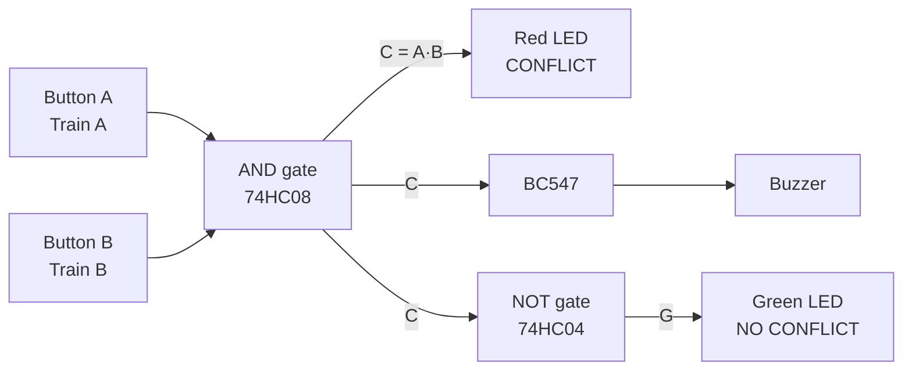

# Railway Track Collision Prevention System

A microcontroller-free digital electronics project that detects a potential conflict when two trains enter a shared railway crossing. It is built from logic gates (74HC-series ICs), push buttons, LEDs and a buzzer on a breadboard.

> **Note:** This is a simplified educational model for a Digital Systems Lab. It *detects* a conflict condition and raises a warning. It does not control or stop trains, and it is not a certified railway safety system.

Demo 


## Overview

Two push buttons simulate two trains (Train A and Train B) entering the same restricted area.

- An **AND gate (74HC08)** outputs HIGH only when both trains are present.
- That output turns on the **red LED** and, through a BC547 transistor, the **buzzer**.
- A **NOT gate (74HC04)** inverts the same output to drive the **green LED**, which shows that no conflict is detected.



## Truth Table

| Train A | Train B | Green LED | Red LED | Buzzer |
|:---:|:---:|:---:|:---:|:---:|
| 0 | 0 | ON | OFF | OFF |
| 1 | 0 | ON | OFF | OFF |
| 0 | 1 | ON | OFF | OFF |
| 1 | 1 | OFF | ON | ON |

```
C = A · B          (conflict detected)
G = NOT (A · B)    (no conflict detected)
```

The green LED means only that *no conflict is detected*. It does not prove the track is safe.

## Components

| Component | Specification | Qty | Purpose |
|---|---|:---:|---|
| AND gate IC | 74HC08 | 1 | Detects both trains present |
| NOT gate IC | 74HC04 | 1 | Drives the green LED |
| Push buttons | Normally open | 2 | Simulate Train A and Train B |
| Red LED | 5 mm | 1 | Conflict indicator |
| Green LED | 5 mm | 1 | No-conflict indicator |
| Active buzzer | 5 V, low current | 1 | Audible warning |
| NPN transistor | BC547 | 1 | Switches the buzzer |
| Resistor | 10 kΩ | 2 | Pull-down for button inputs |
| Resistor | 1 kΩ | 2 | LED current limiting |
| Resistor | 4.7 kΩ | 1 | Transistor base current limiting |
| Ceramic capacitor | 100 nF | 2 | Supply decoupling, one per IC |
| Breadboard, jumper wires | Standard | 1 set | Assembly |
| Power supply | Regulated 5 V DC | 1 | Power |
| Cardboard or foam board | For the model | 1 | Railway model |

## Circuit Connections

Power both ICs from pin 14 (+5 V) and pin 7 (GND), with a 100 nF capacitor across those pins on each IC.

| From | Through | To |
|---|---|---|
| +5 V | Button A | 74HC08 pin 1 |
| 74HC08 pin 1 | 10 kΩ | GND |
| +5 V | Button B | 74HC08 pin 2 |
| 74HC08 pin 2 | 10 kΩ | GND |
| 74HC08 pin 3 | 1 kΩ | Red LED anode (cathode to GND) |
| 74HC08 pin 3 | Wire | 74HC04 pin 1 |
| 74HC04 pin 2 | 1 kΩ | Green LED anode (cathode to GND) |
| 74HC08 pin 3 | 4.7 kΩ | BC547 base |
| BC547 collector | Wire | Buzzer negative |
| Buzzer positive | Wire | +5 V |
| BC547 emitter | Wire | GND |
| Pin 14 of each IC | 100 nF | Pin 7 of the same IC |

**Unused pins:** CMOS inputs must never float, so tie every unused input to GND and leave unused outputs open.

| IC | Unused inputs (to GND) | Unused outputs (open) |
|---|---|---|
| 74HC08 | 4, 5, 9, 10, 12, 13 | 6, 8, 11 |
| 74HC04 | 3, 5, 9, 11, 13 | 4, 6, 8, 10, 12 |

[Circuit diagram]


## Build and Test

1. Place both ICs across the breadboard gap and wire the power pins and capacitors.
2. Wire the inputs, gates, LEDs and buzzer driver using the table above.
3. **Check the pinout of your own BC547 and confirm the buzzer is an active 5 V type before powering on.**
4. Run these tests:

| Test | Action | Expected result |
|:---:|---|---|
| 1 | Release both buttons | Green ON; red and buzzer OFF |
| 2 | Press A only | Green ON; red and buzzer OFF |
| 3 | Press B only | Green ON; red and buzzer OFF |
| 4 | Hold A, then press B | Green OFF; red ON; buzzer sounds |

Once all four pass, mount the circuit on a cardboard railway model with two tracks, two paper trains and a button beside each train.

## Design Notes

- **Why 74HC and not plain 7408/7404?** HC chips are CMOS, so a 10 kΩ pull-down gives a clean LOW. Standard TTL inputs draw too much current for that to work.
- **Why the transistor?** The buzzer needs more current than a gate output should supply, so the BC547 works as a switch.
- **Why tie unused inputs to GND?** Floating CMOS inputs pick up noise and can cause wrong outputs.
- **Why the 100 nF capacitors?** They decouple the supply so gate switching does not disturb the ICs.

## Limitations

- Buttons stand in for sensors, and each is momentary.
- The circuit only warns; it does not stop or control anything.
- There is no fail-safe behaviour: if power or an input fails, no warning appears.
- Real railway systems use track-occupancy sensing, interlocking and certified fail-safe design.

## Future Improvements

- Latch the conflict with a flip-flop until a reset button is pressed.
- Replace buttons with IR or reed-switch sensors.
- Add more track sections with extra gates.
- Drive a relay or servo to operate a crossing barrier.

## Documentation

- Project report (PDF)(https://github.com/user-attachments/files/34003077/Project.Report.pdf)


## Team

Batch 2-Group 8, Digital Systems Lab, Department of Electronics and Communication Engineering, Saintgits College of Engineering.

- Sethuparvathy K J
- Shaheem Ahamed
- Robin Kirian Abraham
